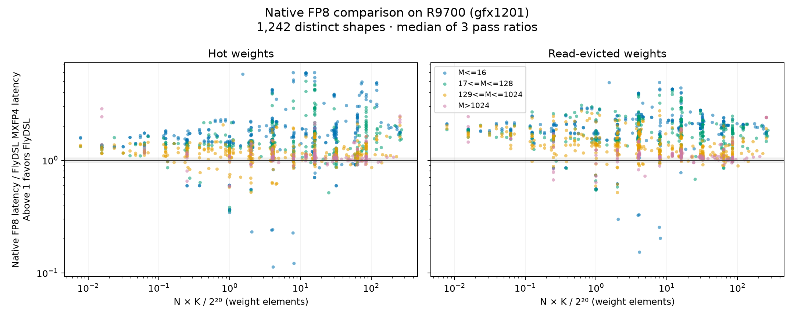
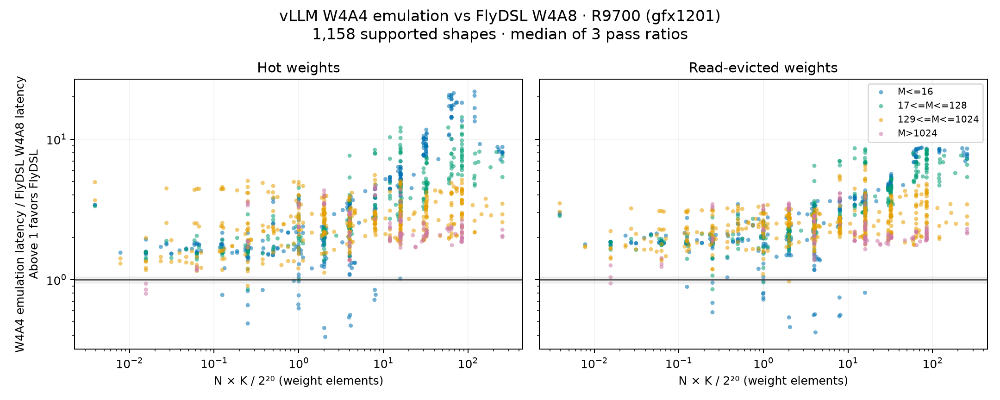

# FlyDSL MXFP4 benchmark report — R9700 / gfx1201

Completed measurements, 16 November 2026.

## Current kernel and measurement scope

The current PR implementation ([`495bb86`](https://github.com/big-yellow-duck/FlyDSL/commit/495bb86d30e3d5062444b867f4a5c9348dfea151)) uses **E5M2 as its only folded weight format**, with grouped K32 scaling when folding would lose information. Weights stay packed as MXFP4 in GPU memory and are decoded into E5M2 fragments inside GEMM. Activations remain E4M3. Config selection uses one set of shape/hardware rules; the caller-facing cache-policy hint has been removed.

There are two separate sets of performance evidence:

| Experiment | Weight formats measured | Coverage |
| --- | --- | --- |
| Full arbitrary-shape sweep below | E4M3 folding at `3ed2ca5` | 1,842 unique shapes, three passes |
| [Paired E4M3/E5M2 comparison](../flydsl-weight-format-20261116/REPORT.md) | Both formats, identical inputs/configs | 20 shape/scale cases, three passes |

In the paired comparison, E5M2 was about 0.6% slower hot and 0.4% slower read-evicted for the 12 ordinary-scale shapes. For wider scale spans requiring E4M3 subnormal handling, E5M2 was 2.6–3.1% faster hot across the four tested shapes per span, with little read-evicted difference. All 60 paired evaluations produced bitwise-identical BF16 outputs. These are targeted measurements supporting the format simplification; the full sweep has **not** been rerun on the E5M2-only revision.

## Recorded full-sweep results

The following timings retain the revision and formats actually measured: FlyDSL [`3ed2ca5`](https://github.com/big-yellow-duck/FlyDSL/commit/3ed2ca5f68ecc2fd972cb23d4da366364e91d261) with E4M3-folded weights. They must not be read as E5M2-only full-sweep results.

See [reproduction commands and artifact layout](REPRODUCE.md). Performance aggregates below come from the full three-pass sweeps; preflight timings are excluded.

In the recorded sweep, against native predecoded FP8, FlyDSL MXFP4 achieved **1.345× hot / 1.552× read-evicted** equal-weight geometric-mean speedup across 1,242 shapes. Against vLLM’s historical-default W4A4 emulation path, the benchmarked FlyDSL W4A8 layer path achieved **2.897× / 2.682×** across 1,158 supported shapes. The two comparisons have different input precision, measured operations, and shape domains.

Performance is not uniformly better. The lowest native hot speedup is **0.113×** at **M=8, N=528, K=8192**: FlyDSL **89.59 µs** versus native FP8 **10.06 µs**, with pass ratios **0.112–0.113×**. The worst-case tables and per-shape CSVs retain these regressions. No kernel or selector changes were made during the sweep.

The six lowest native hot ratios occur at M=8, N∈{528,1008,1040}, and K∈{4096,8192}. These N values are divisible by 16 but not 32. This is a repeatable small-M/alignment pattern, not a single noisy sample; the measurements alone do not establish its compiler or kernel-level cause.

The source audit confirms that the checkpoint-default gfx1201 path used W4A4 emulation before FlyDSL. This report measures synthetic linear layers through the vLLM implementations at the recorded revision, including their activation quantizers. It does not measure model throughput or task accuracy.

## Coverage and validation

| Experiment | Unique shapes / configurations | Evaluations over 3 passes | Outcome |
| --- | --- | --- | --- |
| Native FP8 pairs, auto selection | 1,242 shapes | 3,726 | All passed |
| Native policy sensitivity | 60 shapes × 2 extra policies | 360 | All passed |
| Native-script N-tail diagnostics | 600 shapes | 1,800 | FlyDSL only; all passed |
| vLLM W4A4 / W4A8 pairs | 1,158 shapes | 3,474 | Both backends passed |
| vLLM emulation unsupported | 684 shapes | 2,052 | Explicit Quark rejection; FlyDSL passed |

The native sweep completed all 1,266 grouped jobs and 9,972 method rows. The vLLM sweep completed all 102 batch jobs and 5,526 shape rows. There are no missing shapes or unexpected failures in the final ledgers. Expected emulation rejections remain in the data and have no speedup ratio.

Every native timing passes an independent sampled FP32 reference and changed-input graph replay check. The separate full-output kernel suite for this source revision passed **96 tests with 10 expected skips** for unsupported grouped-scaling/hybrid combinations ([test log](../flydsl-pr1374-final-20261116/tests.log)). Each vLLM arm passes its own sampled quantization-aware reference, and every captured graph passes changed-input replay checks. Sampled references cover up to 32×64 output entries and use a relative RMS limit of 0.005; they are not full-output checks for every sweep shape.

## Native FP8 comparison

Both methods consume the same E4M3 activations and mathematically identical weights, and produce BF16 output. The native `torch._scaled_mm` arm stores weights as losslessly predecoded FP8 outside timing. FlyDSL keeps packed MXFP4 weights and decodes inside GEMM. Activation scales are one; neither arm includes dynamic activation quantization. This measures a compressed-weight execution tradeoff, not hardware FP4 instructions or equal weight storage.

Here, “native FP8” names the PyTorch `_scaled_mm` backend. The vendor GEMM’s generated instructions were not profiled, so this report does not identify its internal instruction selection.

| Regime | Shapes | Geomean speedup | Median speedup | Range | Consistent wins | Consistent losses | Small/inconsistent |
| --- | --- | --- | --- | --- | --- | --- | --- |
| Hot | 1,242 | 1.345× | 1.278× | 0.113–5.987× | 971 | 96 | 175 |
| Read-evicted | 1,242 | 1.552× | 1.567× | 0.152–4.895× | 1084 | 57 | 101 |

| Group | Shapes | Hot geomean | Read-evicted geomean |
| --- | --- | --- | --- |
| M≤16 | 380 | 1.654× | 1.886× |
| 17≤M≤128 | 298 | 1.433× | 1.759× |
| 129≤M≤1024 | 416 | 1.140× | 1.330× |
| M>1024 | 148 | 1.108× | 1.130× |

The observed native advantage is largest in the M≤16 band (1.654× hot / 1.886× read-evicted) and smaller for M>1024 (1.108× / 1.130×). The bands contain different N/K shapes, so this is a workload-band observation rather than an isolated causal effect of M.

Cohorts overlap, so their counts must not be added. The overall results deduplicate shapes and exclude extra selection policies and N-tail diagnostics.

| Group | Shapes | Hot geomean | Read-evicted geomean |
| --- | --- | --- | --- |
| A-core | 280 | 1.413× | 1.619× |
| B-m-boundaries | 240 | 1.310× | 1.447× |
| C-n-boundaries | 240 | 1.290× | 1.474× |
| D-k-factors | 350 | 1.344× | 1.682× |
| E-cache-footprint | 48 | 1.461× | 1.596× |
| F-reserved | 128 | 1.355× | 1.432× |

The 128 reserved arbitrary shapes retain an average advantage: 1.355× hot and 1.432× read-evicted. They also contain 13 consistent hot losses and 6 read-evicted losses. This cohort was frozen before the run and was not used to change the implementation; it does not establish performance for every possible shape.

## vLLM W4A4 emulation comparison

The cached `amd/Qwen3.8-27B-Quark-AWQ-MXFP4` configuration declares static MXFP4 weights and dynamic group-32 MXFP4 activations. In the source before FlyDSL was introduced (`335dd77b09161c5d63139b4e7ae51bb9928305b1`), ROCm tried RDNA3 W4A8, AITER MXFP4, then emulation. RDNA3 rejected gfx1201, and AITER required native MX support absent on gfx1201. Emulation was therefore the compatible default when Quark was installed. Commit `4816c7b43f52a09efd09409e6a023b5dd31579f5` later made the RDNA4 candidate substitute per-token FP8 activations. Historical dispatch is established from source history; the historical server binary was not run. The harness verified that the recorded revision’s auto selector chose FlyDSL W4A8 and explicit emulation chose W4A4. See [dispatch audit](vllm-audit/README.md) and [exact evidence](vllm-audit/evidence.json).

Both arms start with identical packed MXFP4 weights/scales and the same BF16 input. The timed GPU work is vLLM `apply_weights`: W4A4 activation QDQ, **per-call weight dequantization**, and BF16 `F.linear` versus dynamic per-token FP8 quantization and the FlyDSL GEMM. FlyDSL post-load preparation stays outside timing. `VLLM_MXFP4_EMULATION_DEQUANT_AT_LOAD=0` matches the historical default; the opt-in cached-weight emulation variant is not benchmarked. The measured vLLM revision passed `cache_policy='rotating'`, which the frozen harness preserves for both timing regimes. The updated integration no longer passes this removed parameter.

| Regime | Shapes | Geomean speedup | Median speedup | Range | Consistent wins | Consistent losses | Small/inconsistent |
| --- | --- | --- | --- | --- | --- | --- | --- |
| Hot | 1,158 | 2.897× | 2.650× | 0.391–21.812× | 1132 | 19 | 7 |
| Read-evicted | 1,158 | 2.682× | 2.508× | 0.421–8.714× | 1133 | 18 | 7 |

| Group | Shapes | Hot geomean | Read-evicted geomean |
| --- | --- | --- | --- |
| M≤16 | 349 | 3.154× | 2.709× |
| 17≤M≤128 | 252 | 3.517× | 3.278× |
| 129≤M≤1024 | 434 | 2.581× | 2.504× |
| M>1024 | 123 | 2.301× | 2.198× |

| Group | Shapes | Hot geomean | Read-evicted geomean |
| --- | --- | --- | --- |
| A-core | 280 | 2.805× | 2.541× |
| B-m-boundaries | 213 | 3.517× | 3.226× |
| C-n-boundaries | 240 | 2.929× | 2.587× |
| D-k-factors | 262 | 2.364× | 2.366× |
| E-cache-footprint | 41 | 4.956× | 3.815× |
| G-n-tails | 100 | 2.509× | 2.425× |
| F-reserved | 66 | 3.663× | 3.354× |

Quark 0.12.post1 requires `M*K % 64 == 0` for activation QDQ and `N*K % 512 == 0` for weight dequantization. Of the aligned native domain, 1,058 shapes are comparable and 184 fail activation alignment. Of the 600 N-tail shapes, 100 are comparable, 340 fail weight alignment, and 160 violate both constraints. All 684 rejections were attempted and recorded; dimensions were not padded to manufacture a baseline. [FlyDSL-only layer timings and rejection messages](vllm-flydsl-only.csv) cover those cases.

The maximum sampled own-reference relative RMS across paired shapes/passes was **0** for W4A4 and **0.000305946** for W4A8; the maximum for FlyDSL-only shapes was **0.000272181**. Across paired shapes, the median of the per-shape three-pass median W4A4/W4A8 output deltas was **11.46% relative RMS**, with a maximum per-shape median of **18.64%**. The cross-backend RMS uses W4A8 output as its denominator. It reflects different activation quantizers; it is not a model-quality result or a claim that both paths are numerically interchangeable.

## Absolute latencies and worst cases

Latencies below are median microseconds across the three pass medians. Speedup is the median of the three paired pass ratios, so it need not equal the displayed median-latency ratio exactly.

**Native FP8: selected decode, prefill, boundary, and large shapes**

| M×N×K | Regime | Baseline µs | FlyDSL µs | Speedup |
| --- | --- | --- | --- | --- |
| 1×4096×4096 | hot | 18.33 | 10.14 | 1.797× |
| 1×4096×4096 | rotating | 46.98 | 21.26 | 2.212× |
| 17×5120×17408 | hot | 145.97 | 52.48 | 2.779× |
| 17×5120×17408 | rotating | 157.22 | 82.70 | 1.901× |
| 73×4096×8256 | hot | 54.96 | 47.57 | 1.159× |
| 73×4096×8256 | rotating | 85.06 | 57.38 | 1.477× |
| 128×4096×4096 | hot | 52.43 | 29.87 | 1.804× |
| 128×4096×4096 | rotating | 64.90 | 32.66 | 1.991× |
| 1024×4096×4096 | hot | 182.81 | 171.13 | 1.063× |
| 1024×4096×4096 | rotating | 194.44 | 180.12 | 1.079× |
| 8192×4096×4096 | hot | 1158.38 | 1123.70 | 1.032× |
| 8192×4096×4096 | rotating | 1182.16 | 1115.06 | 1.060× |
| 8192×16384×16384 | hot | 42520.11 | 19661.76 | 2.163× |
| 8192×16384×16384 | rotating | 43841.48 | 18282.65 | 2.395× |

**Native FP8: 10 lowest speedups, hot**

| M×N×K | GPU | Baseline µs | FlyDSL µs | Speedup | Pass range | Classification |
| --- | --- | --- | --- | --- | --- | --- |
| 8×528×8192 | 0 | 10.06 | 89.59 | 0.113× | 0.112–0.113× | consistent loss gt5pct |
| 8×1040×8192 | 0 | 10.81 | 89.28 | 0.121× | 0.121–0.121× | consistent loss gt5pct |
| 8×1008×8192 | 0 | 20.17 | 89.19 | 0.226× | 0.225–0.226× | consistent loss gt5pct |
| 8×528×4096 | 1 | 11.07 | 48.05 | 0.231× | 0.230–0.231× | consistent loss gt5pct |
| 8×1008×4096 | 1 | 11.44 | 47.83 | 0.239× | 0.239–0.240× | consistent loss gt5pct |
| 8×1040×4096 | 0 | 11.54 | 47.88 | 0.241× | 0.241–0.241× | consistent loss gt5pct |
| 16×64×16384 | 1 | 8.40 | 24.55 | 0.343× | 0.341–0.344× | consistent loss gt5pct |
| 32×64×16384 | 1 | 8.74 | 24.74 | 0.354× | 0.353–0.355× | consistent loss gt5pct |
| 8×64×16384 | 1 | 8.38 | 23.48 | 0.358× | 0.357–0.359× | consistent loss gt5pct |
| 4×64×16384 | 1 | 8.38 | 23.13 | 0.363× | 0.362–0.364× | consistent loss gt5pct |

**Native FP8: 10 lowest speedups, rotating**

| M×N×K | GPU | Baseline µs | FlyDSL µs | Speedup | Pass range | Classification |
| --- | --- | --- | --- | --- | --- | --- |
| 8×528×8192 | 0 | 20.68 | 135.70 | 0.152× | 0.152–0.153× | consistent loss gt5pct |
| 8×1040×8192 | 0 | 27.52 | 135.92 | 0.202× | 0.202–0.203× | consistent loss gt5pct |
| 8×1008×8192 | 0 | 34.38 | 135.62 | 0.254× | 0.253–0.256× | consistent loss gt5pct |
| 8×528×4096 | 1 | 22.12 | 74.24 | 0.298× | 0.296–0.299× | consistent loss gt5pct |
| 8×1008×4096 | 1 | 23.82 | 73.52 | 0.324× | 0.324–0.329× | consistent loss gt5pct |
| 8×1040×4096 | 0 | 24.08 | 73.62 | 0.327× | 0.325–0.328× | consistent loss gt5pct |
| 192×256×8224 | 1 | 37.36 | 72.44 | 0.516× | 0.515–0.517× | consistent loss gt5pct |
| 64×64×16384 | 1 | 19.16 | 35.34 | 0.542× | 0.542–0.545× | consistent loss gt5pct |
| 16×64×16384 | 1 | 19.30 | 35.48 | 0.545× | 0.544–0.549× | consistent loss gt5pct |
| 32×64×16384 | 1 | 19.40 | 35.30 | 0.550× | 0.549–0.550× | consistent loss gt5pct |

**vLLM emulation: selected decode, prefill, boundary, and large shapes**

| M×N×K | Regime | Baseline µs | FlyDSL µs | Speedup |
| --- | --- | --- | --- | --- |
| 1×4096×4096 | hot | 75.45 | 13.10 | 5.746× |
| 1×4096×4096 | rotating | 98.94 | 24.60 | 4.022× |
| 17×5120×17408 | hot | 736.98 | 60.66 | 12.140× |
| 17×5120×17408 | rotating | 749.13 | 90.38 | 8.299× |
| 73×513×4096 | hot | 28.68 | 12.37 | 2.321× |
| 73×513×4096 | rotating | 41.58 | 18.32 | 2.270× |
| 73×4096×8256 | hot | 227.91 | 52.46 | 4.343× |
| 73×4096×8256 | rotating | 239.40 | 66.24 | 3.608× |
| 128×4096×4096 | hot | 105.57 | 34.79 | 3.037× |
| 128×4096×4096 | rotating | 124.84 | 38.48 | 3.208× |
| 1024×4096×4096 | hot | 430.11 | 198.72 | 2.167× |
| 1024×4096×4096 | rotating | 443.59 | 215.52 | 2.060× |
| 8192×4096×4096 | hot | 2758.87 | 1277.27 | 2.160× |
| 8192×4096×4096 | rotating | 2688.87 | 1360.28 | 1.983× |
| 8192×16384×16384 | hot | 41432.87 | 20579.07 | 2.010× |
| 8192×16384×16384 | rotating | 40738.97 | 19007.53 | 2.135× |

**vLLM emulation: 10 lowest speedups, hot**

| M×N×K | GPU | Baseline µs | FlyDSL µs | Speedup | Pass range | Classification |
| --- | --- | --- | --- | --- | --- | --- |
| 8×528×4096 | 1 | 19.31 | 49.48 | 0.391× | 0.389–0.391× | consistent loss gt5pct |
| 8×256×8224 | 1 | 22.27 | 49.27 | 0.453× | 0.452–0.454× | consistent loss gt5pct |
| 8×528×8192 | 1 | 42.23 | 89.80 | 0.471× | 0.470–0.471× | consistent loss gt5pct |
| 1×16×16384 | 0 | 13.27 | 27.23 | 0.487× | 0.478–0.488× | consistent loss gt5pct |
| 8×1008×4096 | 0 | 26.53 | 49.41 | 0.538× | 0.537–0.541× | consistent loss gt5pct |
| 8×1040×4096 | 0 | 27.69 | 49.42 | 0.560× | 0.560–0.561× | consistent loss gt5pct |
| 2×64×16384 | 0 | 16.74 | 26.89 | 0.625× | 0.618–0.987× | small or inconsistent |
| 16×16×16384 | 0 | 18.68 | 28.37 | 0.658× | 0.656–0.659× | consistent loss gt5pct |
| 8×256×4064 | 0 | 17.54 | 26.41 | 0.666× | 0.662–0.678× | consistent loss gt5pct |
| 8×1008×8192 | 1 | 64.23 | 89.57 | 0.718× | 0.690–0.720× | consistent loss gt5pct |

**vLLM emulation: 10 lowest speedups, rotating**

| M×N×K | GPU | Baseline µs | FlyDSL µs | Speedup | Pass range | Classification |
| --- | --- | --- | --- | --- | --- | --- |
| 8×528×8192 | 1 | 57.34 | 136.66 | 0.421× | 0.420–0.422× | consistent loss gt5pct |
| 8×528×4096 | 1 | 34.80 | 75.82 | 0.460× | 0.457–0.460× | consistent loss gt5pct |
| 8×256×8224 | 1 | 40.22 | 74.78 | 0.538× | 0.538–0.538× | consistent loss gt5pct |
| 8×1008×8192 | 1 | 75.02 | 136.78 | 0.548× | 0.547–0.551× | consistent loss gt5pct |
| 8×1008×4096 | 0 | 42.04 | 75.32 | 0.559× | 0.557–0.560× | consistent loss gt5pct |
| 8×1040×8192 | 1 | 76.62 | 136.60 | 0.561× | 0.560–0.562× | consistent loss gt5pct |
| 8×1040×4096 | 0 | 42.58 | 75.32 | 0.567× | 0.564–0.567× | consistent loss gt5pct |
| 1×16×16384 | 0 | 22.96 | 39.48 | 0.586× | 0.582–0.590× | consistent loss gt5pct |
| 16×16×16384 | 0 | 28.72 | 41.96 | 0.683× | 0.682–0.693× | consistent loss gt5pct |
| 2×64×16384 | 0 | 27.96 | 38.76 | 0.721× | 0.720–0.722× | consistent loss gt5pct |

## Supplemental decoder diagnostic

After GPU 0’s main sweeps, a separate three-pass experiment toggled only the existing register decoder between ALU and LUT at M=1/8 for the two N/K pairs below. It reused the unchanged native benchmark and kept all other config fields fixed. These measurements are excluded from every main sweep aggregate, and the selector was held fixed during the experiment. A LUT/ALU ratio above one favors ALU.

| M×N×K | Regime | Default decoder | ALU µs | LUT µs | Native FP8 µs | LUT/ALU | Pass range |
| --- | --- | --- | --- | --- | --- | --- | --- |
| 1×528×8192 | hot | alu | 12.01 | 11.28 | 9.84 | 0.937× | 0.937–0.940× |
| 1×528×8192 | rotating | alu | 19.58 | 18.50 | 20.46 | 0.945× | 0.941–0.947× |
| 1×1040×4096 | hot | alu | 7.33 | 6.98 | 11.18 | 0.953× | 0.947–0.957× |
| 1×1040×4096 | rotating | alu | 13.10 | 12.50 | 23.50 | 0.954× | 0.946–0.954× |
| 8×528×8192 | hot | lut | 91.41 | 87.45 | 9.83 | 0.959× | 0.955–0.960× |
| 8×528×8192 | rotating | lut | 140.66 | 133.18 | 20.48 | 0.946× | 0.945–0.949× |
| 8×1040×4096 | hot | alu | 46.46 | 44.52 | 11.21 | 0.956× | 0.891–0.958× |
| 8×1040×4096 | rotating | alu | 72.04 | 68.64 | 23.58 | 0.954× | 0.952–0.998× |

Switching to ALU does not fix either M8 regression. At `(8,528,8192)`, hot ALU/LUT medians are 91.41/87.45 µs versus 9.83 µs for native FP8. At `(8,1040,4096)`, they are 46.46/44.52 µs versus 11.21 µs. LUT is slightly faster in these checks, while the large slowdown persists. The decoder choice is therefore insufficient to explain the regression; its kernel/compiler-level cause remains unresolved. The measured defaults were LUT for the first shape and ALU for the second. See [raw diagnostic passes](gpu0/outlier-diagnostic/), [configs and plan](outlier-diagnostic/), and [comparison CSV](outlier-diagnostic/decoder-comparison.csv).

## Historical selection-policy sensitivity

Before the policy parameter was removed, the 60 planned sensitivity shapes were also measured under explicit `hot` and `rotating` selection policies. These policy names choose configs; both timing regimes were measured under each policy. The following uses the same 60-shape subset for all policies, with each speedup calculated against its paired native baseline. Policy jobs may be assigned to different GPUs, so this is a diagnostic of baseline-relative results rather than a direct same-GPU config ablation. A subsequent [config audit](cache-policy-config-diff.json) found that all 60 shapes selected identical configs under these policies; their small timing differences are not evidence of a policy benefit.

| Selection policy | Shapes | Hot geomean | Read-evicted geomean |
| --- | --- | --- | --- |
| auto | 60 | 1.527× | 1.633× |
| hot | 60 | 1.530× | 1.634× |
| rotating | 60 | 1.526× | 1.633× |

## Measurement protocol and reproducibility

Two AMD Radeon AI PRO R9700 GPUs (gfx1201, 32 GB class) ran one measurement process each. GPU 0 is PCI `0000:54:00.0`; GPU 1 is `0000:72:00.0`. Both expose 64 MiB last-level data cache and 64 KiB LDS to the selector, with Torch reporting 32 processor units (AMD SMI reports 64 compute units). All paired methods and all passes for a given job remain on the same GPU. No clock or power settings were changed. Periodic hardware snapshots are point samples, often between processes, and do not establish sustained clocks or power. GPU 1 paused for 712 seconds between native child processes for the vLLM preflight; no native timed samples overlapped that work. One runner wall time includes that pause, while its GPU-event samples were already complete.

At 15:31 local time, a GPU 0 snapshot reported `THROTTLED` at 21 W and edge/hotspot/VRAM temperatures of 50/51/52°C. Available throttle reason/counter fields returned `N/A`; a follow-up at 15:32 reported `UNTHROTTLED`, 15 W, and 0% graphics activity. The cause and overlap with a timed kernel cannot be determined from these point samples. No absence-of-throttling claim is made. See [hardware snapshots](gpu0/hardware-conditions.log), [counter investigation](gpu0/throttle-investigation.log), and [follow-up detail](gpu0/throttle-status-detail.log).

A second GPU 0 `THROTTLED` sample occurred during the vLLM stage at 15:55:46, reporting 275 W and 63/79/76°C. At 15:55:50 the follow-up was `UNTHROTTLED`, 26 W, and 59/60/62°C; reason/counter fields again returned `N/A`. This is retained as an observed condition with an undetermined cause, rather than classified as a thermal or power-limit event. See [repeat investigation](gpu0/throttle-repeat-details.log) and the full hardware log for subsequent samples.

The following summarizes the retained periodic point samples, including later vLLM-stage samples. Sampling is sparse and often falls between jobs; these are observed ranges/counts rather than sustained-load measurements or throttling rates.

| GPU | Status samples | THROTTLED labels | Observed power range | Max edge | Max hotspot | Max VRAM |
| --- | --- | --- | --- | --- | --- | --- |
| 0 | 15 | 8 | 15–275 W | 65°C | 80°C | 78°C |
| 1 | 17 | 6 | 18–224 W | 65°C | 74°C | 74°C |

A separate memory check at `(8192,16384,16384)` passed and recorded a PyTorch peak of **5,926,618,624 allocated bytes (5.52 GiB)** and **6,668,943,360 reserved bytes (6.21 GiB)**. These are allocator statistics for that process, not total device memory usage. Its timings are excluded from the main aggregates; see [profile log](gpu0/profiling/largest-native-profile.log) and [wrapper](gpu0/profiling/profile_peak_memory.py).

Each pass uses 16 randomized paired event rounds. Hot graphs contain eight calls for M<128 and two otherwise, with a replay before the measured replay. The read-evicted regime reads a 256 MiB conditioning buffer and activation data outside events, then times one call. It is a cache-conditioning proxy, not measured DRAM traffic or full-model layer cycling. Compilation, capture, correctness checks, and one-time weight preparation are excluded. GPU events exclude Python dispatch and host allocator costs. Jobs are shuffled with seeds 1374/1375/1376; vLLM synthetic data seeds are 20261116/17/18. Native data follows the unchanged benchmark’s seed-42 generator with shuffled M order. Cohorts were interleaved for execution, and the implementation was frozen throughout; no selector tuning was performed on reserved shapes.

For every shape/pass/regime, speedup is baseline median latency divided by FlyDSL median latency. Three pass ratios are combined using their median. Overall speedups are equal-weight geometric means across deduplicated shapes. A consistent win requires all three ratios >1.05; a consistent loss requires all three <0.95. Other cases are labeled small/inconsistent, not proven equivalent. CSV files retain every pass ratio and its range. Equal shape weighting is not a production workload weighting.

Pass-to-pass ratio variation below is `100 × (maximum pass speedup / minimum pass speedup − 1)` for each shape. It summarizes the three observed passes, including input-seed and operating-state variation; it is not a confidence interval or a causal measure of throttling.

| Comparison | Regime | Median variation | 95th percentile | Maximum |
| --- | --- | --- | --- | --- |
| Native FP8 (auto) | hot | 1.00% | 5.76% | 32.97% |
| Native FP8 (auto) | rotating | 1.01% | 5.41% | 26.19% |
| vLLM paired | hot | 1.01% | 5.22% | 65.46% |
| vLLM paired | rotating | 0.98% | 4.30% | 34.29% |

FlyDSL source: `3ed2ca5f68ecc2fd972cb23d4da366364e91d261`; vLLM source: `3c138b588506cf2196e5f183d3fe893d973ec2e3`. Torch: `2.13.0+rocm10.0.0`; Quark: `0.12.post1`. Explicit source paths override installed FlyDSL/vLLM distribution metadata. The matched FlyDSL compiler binary and source hashes are in [provenance.json](provenance.json). The vLLM harness uses a local namespace alias from `flydsl.kernels` to source `kernels`, because the current vLLM integration still imports the old namespace. This benchmark adapter is not a production packaging change. The source runtime, ROCm SDK path, C++ compiler, and AMD SMI path are recorded in [preflight provenance](vllm-audit/preflight-provenance.json).

Runtime inspection confirmed that vLLM’s selector, MXFP4 backend modules, and `_custom_ops.py` load from the stated source checkout. Its compiled `vllm._C` extension comes from the existing archived build at `gfx1201-archive/vllm-sources-20261013/vllm/vllm/_C.abi3.so`, SHA-256 `12b9a06484bb47e5aaf2bdb9fc66a0685871da6d7bd29d7f84e88208b22e591e`. The Python source and compiled-library build identities therefore differ; these measurements describe this recorded environment. Full module origins and hashes are in [runtime provenance](gpu0/vllm-runtime-provenance.json).

Final vLLM harness SHA-256: `d381f39f98f955a8153bac0e779735b80d35647868c566468f17eb63a3389646`. The preflight used an earlier synchronization placement, so its timings are excluded. Final measurements use conditioning and measured replay queued back-to-back on the same stream.

The synthetic weights use random packed E2M1 values and E8M0 scales 124–131; the measured FlyDSL preparation is the folded E4M3 path. This sweep does not establish performance for E5M2/grouped fallback modes, FP16 outputs, real checkpoint scale distributions, or full model inference. Those paths have separate numerical tests. The model config was inspected for dispatch, but no checkpoint weight tensors were loaded for this sweep.

## Published artifacts

| Artifact | Contents |
| --- | --- |
| [Shape plan](../flydsl-native-sweep-plan-20261116/rdna4_mxfp4_sweep.md) | Exact structured and frozen arbitrary shapes; original proposal retained |
| [Shape manifest](../flydsl-native-sweep-plan-20261116/shape-manifest.json) | Authoritative deduplicated domains and cohort membership |
| [Native paired CSV](native-paired.csv) | All three-pass paired latency summaries and individual pass ratios |
| [Native tail CSV](native-tail-only.csv) | 600 shapes without native FP8 comparison |
| [vLLM paired CSV](vllm-paired.csv) | 1,158 shape pairs, latencies, ratios, numerical errors |
| [vLLM FlyDSL-only CSV](vllm-flydsl-only.csv) | 684 shapes, latency and exact emulation rejection |
| [Native summary](native-summary.json) / [vLLM summary](vllm-summary.json) | Coverage, per-cohort/M-band aggregates, worst cases and failures |
| [GPU 0 raw archive](raw/gpu0.tar.gz) / [GPU 1 raw archive](raw/gpu1.tar.gz) | All native/vLLM raw samples, logs, per-job status and command ledgers; extraction restores original paths |
| [GPU 0 diagnostics](gpu0/) / [GPU 1 diagnostics](gpu1/) | Hardware snapshots, summaries, supplemental diagnostics and runtime provenance |
| [Native runner](run_native_sweep.py) / [vLLM runner](run_vllm_sweep.py) | Reproducible commands and fixed GPU partitions |
| [vLLM harness](vllm-audit/bench_mxfp4_pair.py) / [methods](vllm-audit/methods.md) | Actual backend calls, correctness checks, source evidence and limitations |
| [GPU inventory](gpu-inventory.json) / [static hardware](gpu-static.json) / [package metadata](package-versions.json) | Hardware and environment provenance |

The results and supporting artifacts are published on a separate branch of the author’s FlyDSL fork. No benchmark artifacts are added to the PR branch. Kernel sources were frozen during the measured sweep.
